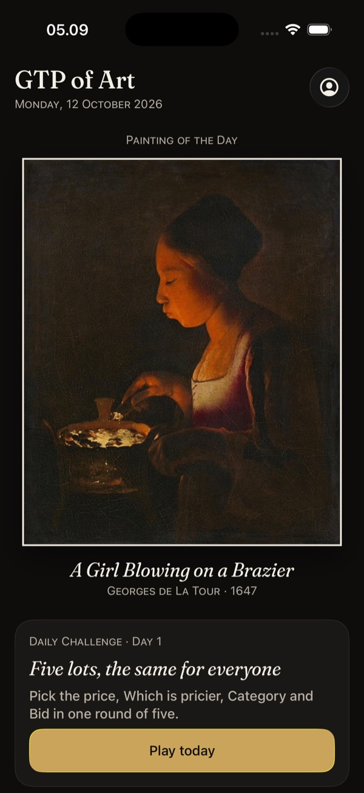
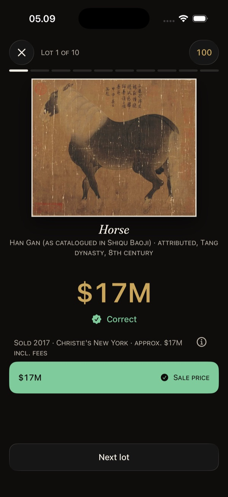
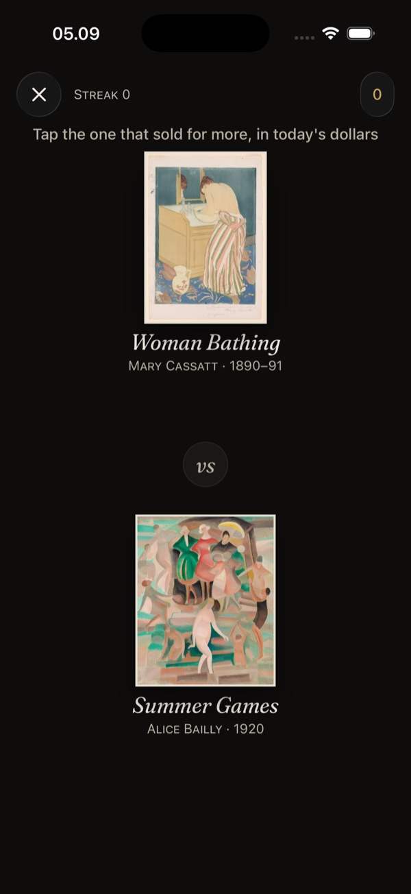
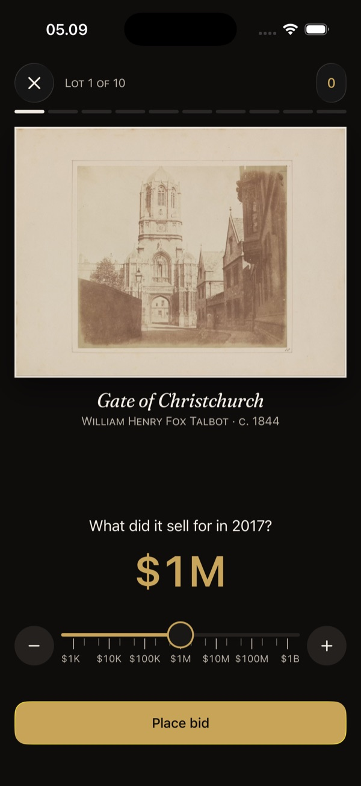
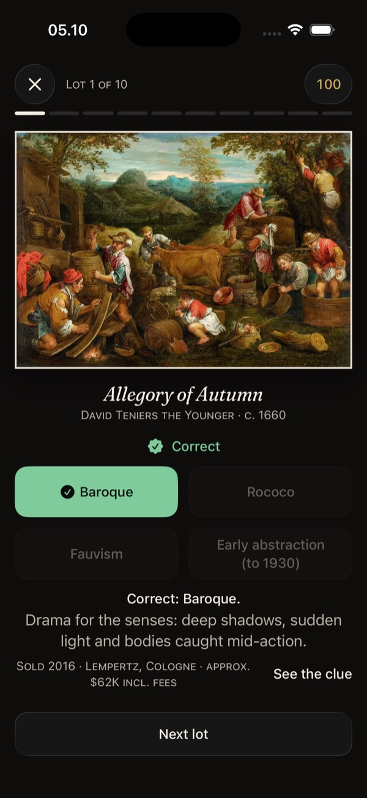
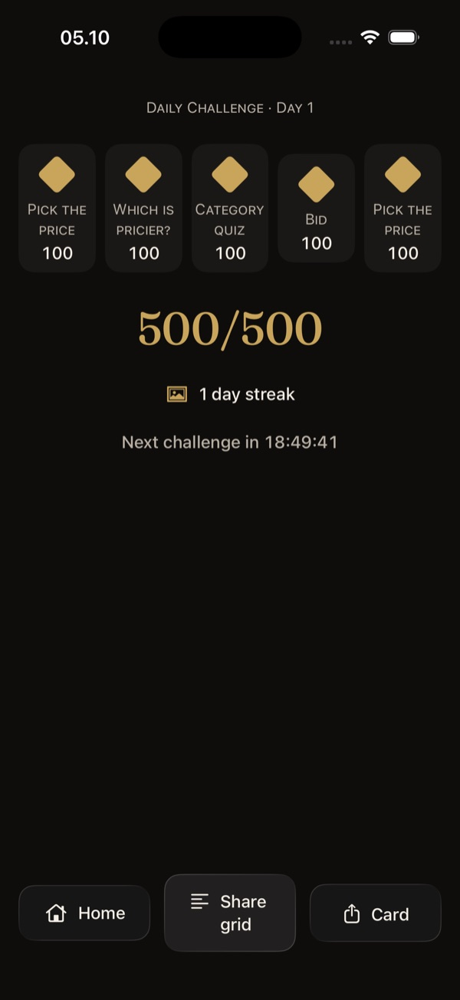

# GTP of Art — Guess the Price of Art

An iPhone game about what real artworks sold for. A Klimt, a Hokusai print, a Toulouse-Lautrec
poster: each one sold at auction or privately, and the figure is on public record. How close can
you get?

Free, offline, no ads, no accounts, no data collected. SwiftUI, iOS 18+.
Website: [gtp-art.aijam.pro](https://gtp-art.aijam.pro) · Support: info@aijam.pro

<p align="center">
  
  
  
  
  
  
</p>

## Six ways to play

| Mode | What you do |
|---|---|
| **Pick the price** | Four prices, one is real. The wrong ones are close enough to make you think. |
| **Which is pricier?** | Two works, one sold for more. Trust your eye and keep the streak alive. |
| **Category quiz** | Baroque, Fauvism or Ukiyo-e? Name the movement or medium and learn its tells. |
| **Bid** | Slide to your own estimate, from a thousand dollars to a billion. Score by how close you land. |
| **Daily challenge** | Five lots a day, the same for everyone. Keep your streak; share the result as a grid. |
| **Swipe** | Keep or pass through a stack of works. The app names your taste and estimates how rare it is. |

Every reveal shows the sale year, the venue, whether the figure includes the buyer's premium, and
an info sheet with the source, an inflation-adjusted estimate and the image credit.

## The collection

417 public-domain works in seven departments (Old Masters, 19th Century, Impressionist & Modern,
Asian Art, Prints & Multiples, Posters, Photographs). 300 carry a documented sale price, from about
$1,000 to more than $400 million, sold between 1885 and 2025. Images come from museum open-access
programmes (The Met, Art Institute of Chicago, Cleveland Museum of Art, Rijksmuseum) and Wikimedia
Commons PD-Art, each with its licence and attribution in `Resources/credits.json` and in the app.

Prices are approximate public figures for historical sales, shown for fun and learning. Nothing in
the app is an appraisal or investment advice.

## How it is built

```
spec/               platform-neutral rules: game-logic.md, dataset.schema.json, fixtures/*.json
Packages/ArtCore    pure game logic, stdlib only (SplitMix64, Fisher–Yates, integer log-scale scoring)
Packages/ArtData    dataset loading and validation, profile store, daily challenge, settings
Packages/ArtDesign  design tokens, typography (Fraunces), components, share cards
App/                SwiftUI app, one folder per feature under App/Features
Resources/          dataset.json, taxonomy.json, taste_baseline.json, credits.json, Artworks/*.heic
tools/              Python pipeline: curation CSV → verified prices, images, validator, review sheet
site/               the static website
```

Design decisions worth knowing:

- **Deterministic rules.** Round selection and scoring are integer-only and seeded, with shared
  fixtures in `spec/fixtures`, so an Android port can match the iOS app bit for bit.
- **Honest prices.** Each price record stores the original amount and currency, nominal USD at the
  sale date, an inflation-adjusted USD figure, the price type (hammer, incl. premium, private sale),
  and whether the image shows the sold object or another impression of the same print.
- **"Salon Noir".** A museum after hours: warm near-black, gilt only where value is involved, Fraunces
  for titles. Light mode gets equal care. Liquid Glass only on static controls, never over artwork.
- **Accessible.** Dynamic Type to the largest accessibility sizes, VoiceOver labels for every
  reveal, a button alternative for every gesture, Reduce Motion and Reduce Transparency respected.

## Building

Requires Xcode 26, [XcodeGen](https://github.com/yonaskolb/XcodeGen) and xcbeautify
(`make setup` installs them with Homebrew and creates the Python venv for the dataset tools).

```bash
make project      # generate ArtPrice.xcodeproj from project.yml
make build        # build for the iOS 26 simulator
make test         # unit test plan (logic, snapshots, accessibility)
make ui-test      # UI smoke plan on iOS 26 and iOS 18 simulators
make test-core    # swift test for the pure logic package (runs on macOS)
make shots        # screenshots of every mode from the simulator
make dataset      # rebuild Resources/ from tools/curation/works.csv
```

See `AGENTS.md` for the working agreement and `docs/release/` for the App Store, privacy and
trademark notes.

## Status

TestFlight (version 1.0). Phase 2 adds a contemporary pack from marketplace feeds and, later, a
subscription that lets artists put their own work in front of the crowd.

## Credits

Artwork images: see `Resources/CREDITS.md` and Profile › Credits in the app. Typeface:
[Fraunces](https://github.com/undercasetype/Fraunces) (SIL Open Font License 1.1).
